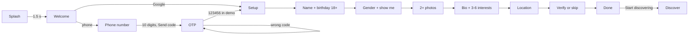
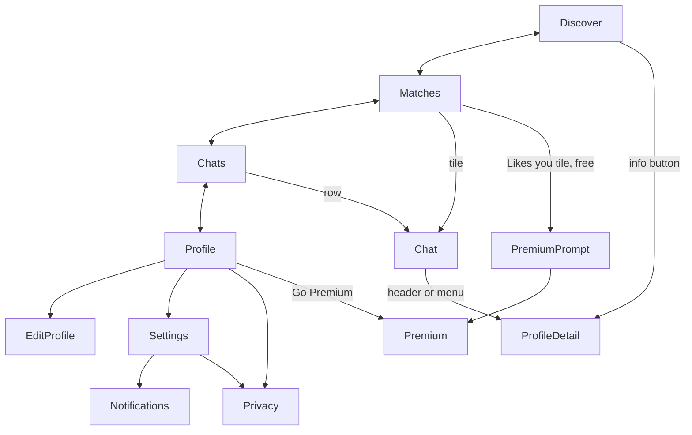
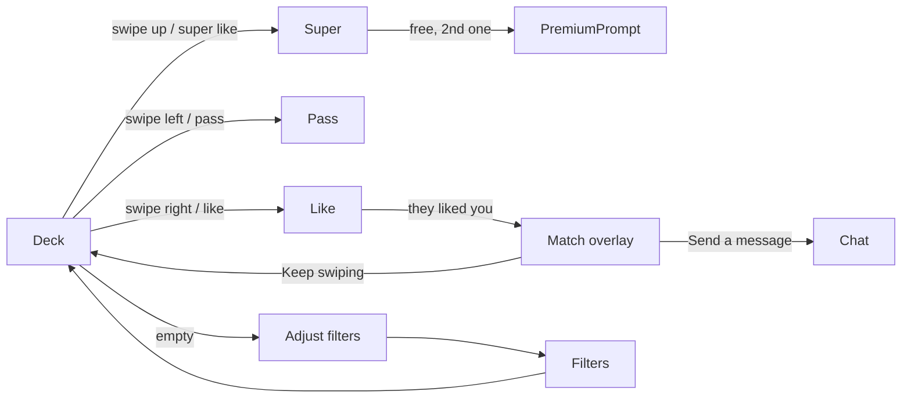
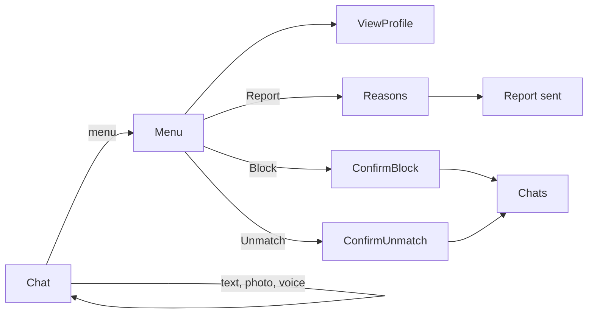
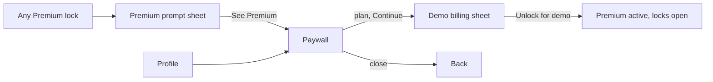

# Navigation flows

Router: `lib/app/router/app_router.dart`. A redirect (`redirect.dart`) keeps each session stage on
its own screens: signed out -> auth screens, onboarding -> `/setup`, signed in -> the tabs.
Tabs are an `indexedStack` (each tab keeps its stack and scroll). Detail screens push over the tabs.

## Sign-in and setup

Back: each setup step goes back one step (system back included); the first step leaves the screen.

## Main navigation

## Discovery and matching

## Messaging and safety

## Subscription

Locks: Likes you (grid is blurred), verified-only filter, Incognito mode, Super Likes beyond the
first. Premium and modal behaviour: the paywall rises from the bottom (full-screen dialog route);
sheets and dialogs use the design system's own routes.
